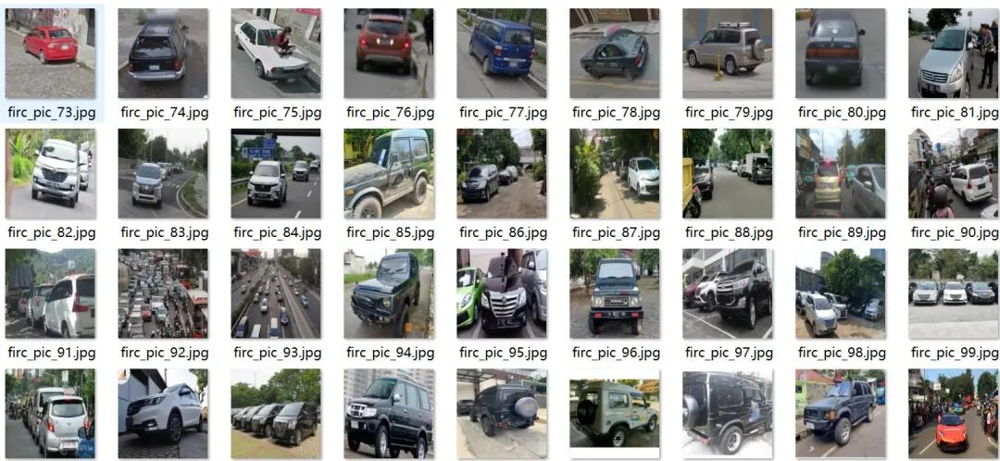
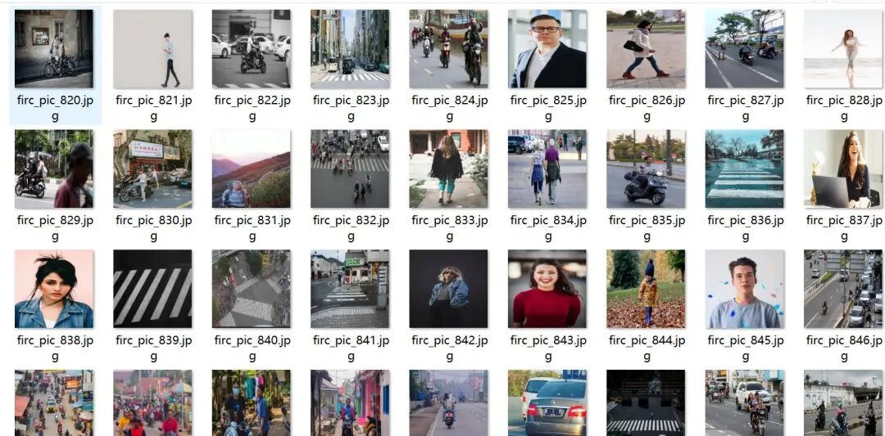
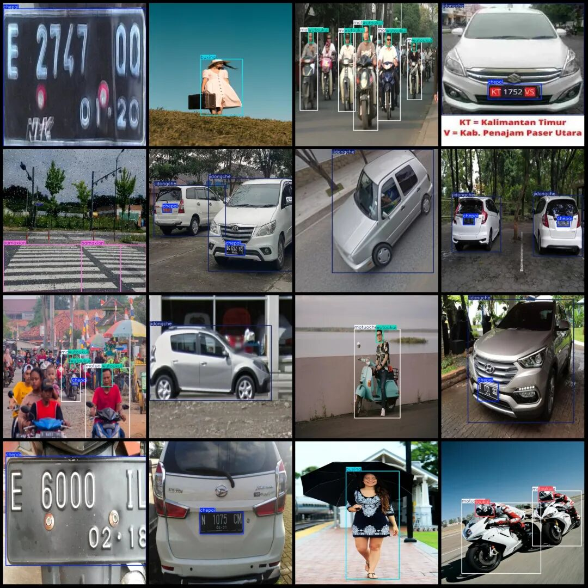
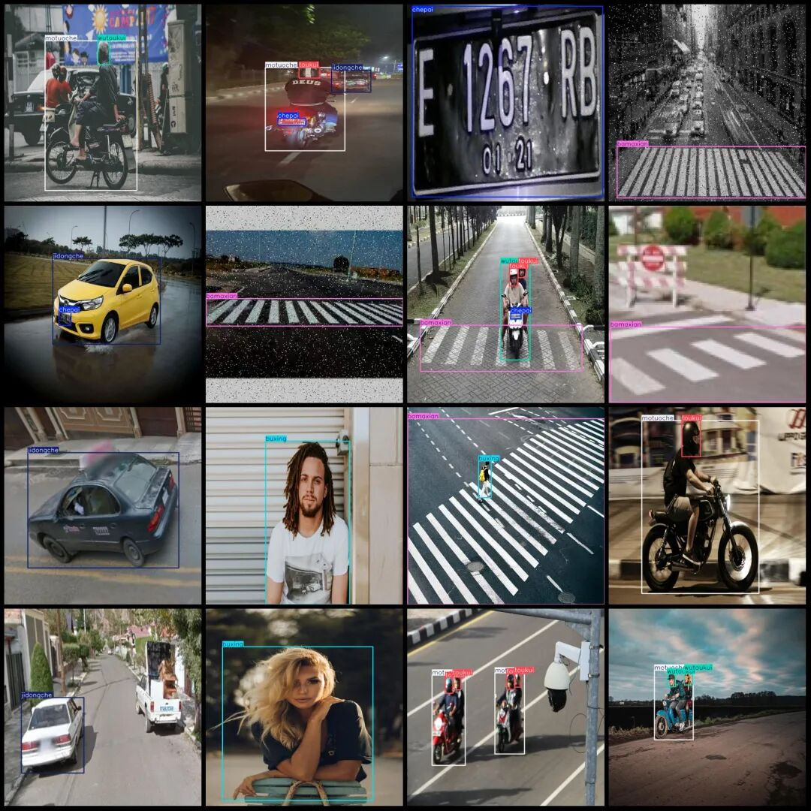

# Traffic Violation Object Detection Dataset VOC+YOLO format with 992 images in 7 categories

Dataset format: Pascal VOC format + YOLO format (txt file without split path, only containing jpg images and corresponding VOC format xml files and yolo format txt files)

Number of images (number of jpg files): 992

Number of annotations (number of xml files): 992

Number of annotations (number of txt files): 992

Label category count: 7

Label category names (Note that the order of categories in the YOLO format does not correspond to this, but is based on the classes.txt file in the labels folder): ["bamaxian", "buxing", "chepai", "jidongche", "motuoche", "toukui", "wutoukui"]

["Zebra Crossing", "Walking", "License Plate", "Motor Vehicle", "Motorcycle", "Helmets", "No Helmet"]

Number of boxes labeled in each category:

bamaxian (zebra line) frame count = 252

buxing (walking/pedestrian) frame count = 391

Chepai (license plate) frame count = 513

jidongche (motor vehicle) frame count = 552

Motoche (motorcycle) frame count = 558

Toukui (helmet) frame count = 420

wutoukui (no helmet) frame count = 260

Total frame count: 2946

Number of images per category:

bamaxian (zebra crossing) occupies = 230

buxing (walking/pedestrian) occupies a picture count = 227

chepai (license plate) occupies = 351

jidongche (motor vehicle) occupies a picture count = 374

Motuoche (motorcycle) occupies a total of 279 images.

Toukui (helmet) occupies a picture count = 177

wutoukui (without helmet) occupies 148 images.

Image resolution: 640x640

Using labelImg:

Annotation rules: Draw a rectangle around the category.

Important Notice: The dataset does not have separate training, validation, and test sets; you need to partition them yourself.

Special : This dataset does not guarantee the accuracy of the trained models or weight files.

Application Scenario: This dataset focuses on the core scenarios of traffic violation detection. In the development of autonomous driving safety systems, it can train models to identify pedestrians, vehicles, and violations such as not wearing helmets or failing to yield to pedestrians. It is used in intelligent transportation management systems to support license plate recognition and zebra crossing detection, aiding in urban smart governance. The data covers daytime/nighttime, diverse weather conditions, and dynamic driving states, with precise annotations for seven key traffic elements (including helmet wearing and pedestrian safety), all annotated according to traffic regulations, supporting complex multi-object detection. It natively supports YOLO format (v8/v11/v26), facilitating industrial-grade training. It can support both driving behavior analysis and safety education applications (such as integrating into driving training systems to provide real-time feedback on dangerous behaviors), as well as providing core training materials for traffic enforcement AI, including not wearing helmets or failing to yield to pedestrians. It has both scientific research and engineering application value.

Image Preview:

Annotation example:

## Payment

Here is a pay link on Stripe ( https://buy.stripe.com/3cs8yP7sY87d0vu9AB ). Please contact me lonlonago@foxmail.com after funding $89, and I will send you a complete data files , thank you!

